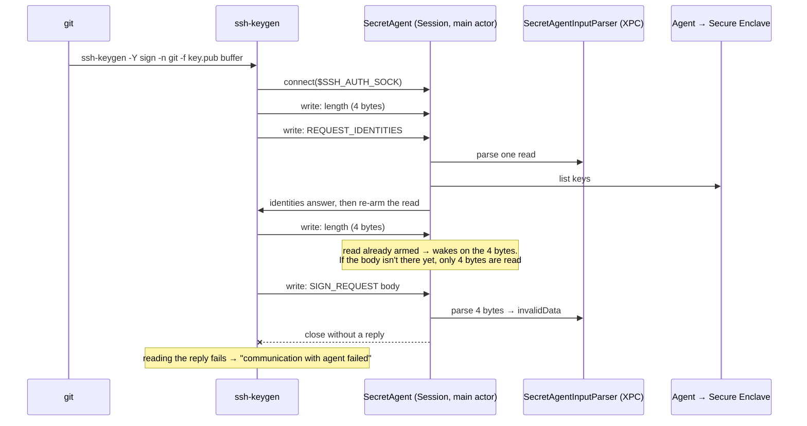

# Secretive SSH agent: short read drops sign requests ("communication with agent failed")

> Upstream issue: [maxgoedjen/secretive#577](https://github.com/maxgoedjen/secretive/issues/577) (also [#579](https://github.com/maxgoedjen/secretive/issues/579)). This document was written as a comment for that issue, so "this thread" and "the original report" refer to #577. Code: [`troubleshooting-1/`](troubleshooting-1/).

**TL;DR:** Secretive's agent treats one socket read as one complete SSH agent message. OpenSSH sends each request as two writes: the 4-byte length, then the body. When the agent reads before the body arrives, it drops the connection, and the client prints `communication with agent failed`. The script below reproduces this every time, and reassembling frames in front of the agent removes the failure.

> **Notice:** I worked through this with an AI assistant (Claude). It read the source, wrote the test script and ran it on my machine. I reviewed the claims before posting. There is no patch for Secretive here. The C code inside the script is a test relay that illustrates the framing technique; it is not proposed code.

**Environment:** Secretive 4.0.0, macOS 27.0.1 (arm64), Apple's `OpenSSH_10.3p1, LibreSSL 3.3.6`, Secure Enclave key with notify-only access.

## 1. What I noticed

My git commits are signed through Secretive (`gpg.format=ssh`). A test suite that creates throwaway git repos inherited my global `commit.gpgsign=true`, so every test commit asked Secretive for a real signature, about 60 per run, from 8 parallel workers. Every run, 1–3 of those signatures failed with:

```
error: Signing file …/.git_signing_buffer_tmp…
Couldn't sign message (signer): communication with agent failed?
fatal: failed to write commit object
```

That is the same output as in the original report. It also happened once on an ordinary `git rebase` with no tests running. Retrying always succeeded.

## 2. Data flow

What one `git commit -S` does, traced with `GIT_TRACE=1` and Secretive's debug log:



When it works, the two writes have both arrived by the time the agent reads them, and the agent answers with the signature from the Secure Enclave.

## 3. Workaround and experiment

**Workaround I'm using:** keep signing out of places that don't need it. The test suite now isolates its git child processes from the user's config (`GIT_CONFIG_GLOBAL` set to an empty file, `GIT_CONFIG_NOSYSTEM=1`, and the `GIT_CONFIG_COUNT`/`KEY_n`/`VALUE_n` variables removed), so no test commit talks to the agent. Real commits can still fail occasionally. Retrying works.

**Experiment:** two small relays between `ssh-keygen` and the agent.
- **split** (Python): forwards bytes unchanged, but writes each frame's 4-byte length and its body as two writes with a gap (`--delay`, default 50 ms).
- **reassemble** (C, compiled at run time): accumulates bytes and forwards only complete frames, one write each. This is what an agent is expected to do on its receiving side.

To run it you need macOS with the Xcode command line tools (`cc`, `git`, `ssh-keygen`), Python 3.8 or later (standard library only), and a Secretive key:

```sh
python3 troubleshooting-1/secretive_repro.py ~/path/to/your-secretive-key.pub
```

Use a **notify-only** key. Every request is a real signature, so a key that requires authentication prompts every time. A notify-only key posts one notification per signature, about 110 for a default run (`--rounds 1` or a smaller `--concurrency` for fewer). Everything runs in a temporary directory under `/tmp` and is removed at the end. No SSH or git configuration is changed. `--agent <path>` selects a different socket.

Output on my machine (the same on two runs):

```
sequential signs
  direct                   5/5 ok
  split                    0/5 ok      Couldn't sign message (signer): communication with agent failed
  split + reassemble       5/5 ok

load: 16 concurrent signs x 3 rounds, no artificial gap
  direct                   48/48 ok
  reassemble               48/48 ok

git commit -S
  split                    exit 128    Couldn't sign message (signer): communication with agent failed? / Signing <tmp>/.git_signing_buffer_tmp… failed: communication with agent failed? / fatal: failed to write commit object
  split + reassemble       exit 0

control: OpenSSH ssh-agent, throwaway ed25519 key
  split -> ssh-agent       5/5 ok
```

- `split` fails and `split + reassemble` passes, so the agent cannot handle a frame that arrives in two reads, and reassembling in front of it removes the failure.
- `git commit -S` through `split` gives exactly the output from the original report.
- OpenSSH's own `ssh-agent` passes behind the same split, so the write pattern itself is valid.
- The load lines have no artificial gap, so they're probabilistic. In this run neither failed. In an earlier run of the same load launched from a shell script, direct failed 3/48 and reassembled 0/48. The gap test is the deterministic reproduction. The load test shows how it turns up in practice.

<details>
<summary><code>secretive_repro.py</code> (Python 3, stdlib only; embeds the C reassembly relay)</summary>

```python
#!/usr/bin/env python3
"""Reproduce "communication with agent failed" from Secretive, and check that
receiver-side reassembly removes it.

All steps use the real ssh-keygen and a real Secretive key:
  1. direct             ssh-keygen -> Secretive
  2. split              ssh-keygen -> relay that sends each frame's 4-byte length
                        and its body as two writes with a gap -> Secretive
  3. split + reassemble ssh-keygen -> same split relay -> C relay that accumulates
                        bytes and forwards only complete frames, one write each
                        -> Secretive
  4. load               N concurrent signs, direct vs through the reassembly relay
  5. git commit -S      through the split relay, with and without reassembly
  6. control            ssh-keygen -> split relay -> OpenSSH's own ssh-agent

The C reassembly relay is embedded below and compiled with `cc` at run time.
It is a test harness that illustrates the technique, not a patch for Secretive.

Requirements: macOS, Python 3.8+, Xcode command line tools (cc, git, ssh-keygen),
and a Secretive key. Every sign request is one Secretive signature: a notify-only
key posts one notification per request, and a key that requires authentication
prompts every time, so use a notify-only key.

Usage:
    python3 secretive_repro.py <path to the Secretive key's .pub>
            [--delay 0.05] [--runs 5] [--concurrency 16] [--rounds 3]
"""
import argparse
import concurrent.futures
import os
import platform
import socket
import struct
import subprocess
import sys
import tempfile
import threading
import time

DEFAULT_AGENT = os.path.expanduser(
    "~/Library/Containers/com.maxgoedjen.Secretive.SecretAgent/Data/socket.ssh"
)

REASSEMBLE_C = r"""
#include <arpa/inet.h>
#include <errno.h>
#include <pthread.h>
#include <signal.h>
#include <stdint.h>
#include <stdio.h>
#include <stdlib.h>
#include <string.h>
#include <sys/socket.h>
#include <sys/un.h>
#include <unistd.h>

#define MAX_LEN (256 * 1024)            /* same cap as OpenSSH AGENT_MAX_LEN */
static const char *agent_path;

static int write_all(int fd, const unsigned char *b, size_t n)
{
    while (n > 0) {
        ssize_t w = write(fd, b, n);
        if (w < 0) { if (errno == EINTR) continue; return -1; }
        b += w; n -= (size_t)w;
    }
    return 0;
}

struct pair { int client, agent; };

static void *agent_to_client(void *p)   /* replies are copied unchanged */
{
    struct pair *x = p;
    unsigned char buf[65536];
    ssize_t r;
    while ((r = read(x->agent, buf, sizeof(buf))) > 0)
        if (write_all(x->client, buf, (size_t)r) < 0) break;
    shutdown(x->client, SHUT_WR);
    return NULL;
}

/* accumulate / extract / keep the remainder; each complete frame -> one write */
static void client_to_agent(int fd, int agent)
{
    static __thread unsigned char acc[4 + MAX_LEN];
    size_t used = 0;
    for (;;) {
        ssize_t r = read(fd, acc + used, sizeof(acc) - used);   /* 1) append */
        if (r == 0) return;
        if (r < 0) { if (errno == EINTR) continue; return; }
        used += (size_t)r;
        size_t off = 0;
        while (used - off >= 4) {                               /* 2) extract */
            uint32_t len;
            memcpy(&len, acc + off, 4);
            len = ntohl(len);
            if (len > MAX_LEN) return;                          /*    cap */
            if (used - off < 4 + (size_t)len) break;            /*    incomplete */
            if (write_all(agent, acc + off, 4 + len) < 0) return;
            off += 4 + len;
        }
        memmove(acc, acc + off, used - off);                    /* 3) keep remainder */
        used -= off;
    }
}

static void *serve(void *p)
{
    int client = (int)(intptr_t)p;
    struct sockaddr_un a;
    memset(&a, 0, sizeof(a));
    a.sun_family = AF_UNIX;
    strncpy(a.sun_path, agent_path, sizeof(a.sun_path) - 1);
    int agent = socket(AF_UNIX, SOCK_STREAM, 0);
    if (agent < 0 || connect(agent, (struct sockaddr *)&a, sizeof(a)) < 0) { close(client); return NULL; }
    struct pair x = { client, agent };
    pthread_t t;
    pthread_create(&t, NULL, agent_to_client, &x);
    client_to_agent(client, agent);
    shutdown(agent, SHUT_WR);
    pthread_join(t, NULL);
    close(agent);
    close(client);
    return NULL;
}

int main(int argc, char *argv[])
{
    if (argc != 3) { fprintf(stderr, "usage: %s <listen> <agent>\n", argv[0]); return 2; }
    signal(SIGPIPE, SIG_IGN);
    agent_path = argv[2];
    struct sockaddr_un l;
    memset(&l, 0, sizeof(l));
    l.sun_family = AF_UNIX;
    strncpy(l.sun_path, argv[1], sizeof(l.sun_path) - 1);
    unlink(argv[1]);
    int s = socket(AF_UNIX, SOCK_STREAM, 0);
    if (s < 0 || bind(s, (struct sockaddr *)&l, sizeof(l)) < 0 || listen(s, 64) < 0) { perror("listen"); return 1; }
    for (;;) {
        int c = accept(s, NULL, NULL);
        if (c < 0) { if (errno == EINTR) continue; perror("accept"); return 1; }
        pthread_t t;
        pthread_create(&t, NULL, serve, (void *)(intptr_t)c);
        pthread_detach(t);
    }
}
"""


# --------------------------------------------------------------- split relay
def recv_exact(sock, n):
    buf = b""
    while len(buf) < n:
        chunk = sock.recv(n - len(buf))
        if not chunk:
            return None
        buf += chunk
    return buf


def shutdown(*socks):
    for s in socks:
        try:
            s.shutdown(socket.SHUT_RDWR)
        except OSError:
            pass


def split_client_to_agent(client, agent, delay):
    """Forward whole frames, writing the length and the body separately."""
    try:
        while True:
            header = recv_exact(client, 4)
            if header is None:
                break
            body = recv_exact(client, struct.unpack(">I", header)[0])
            if body is None:
                break
            agent.sendall(header)
            time.sleep(delay)
            agent.sendall(body)
    except OSError:
        pass
    finally:
        shutdown(client, agent)


def copy_agent_to_client(agent, client):
    try:
        while True:
            data = agent.recv(65536)
            if not data:
                break
            client.sendall(data)
    except OSError:
        pass
    finally:
        shutdown(client)


def start_split_relay(listen_path, agent_path, delay):
    server = socket.socket(socket.AF_UNIX, socket.SOCK_STREAM)
    server.bind(listen_path)
    server.listen(64)

    def serve():
        while True:
            client, _ = server.accept()
            agent = socket.socket(socket.AF_UNIX, socket.SOCK_STREAM)
            agent.connect(agent_path)
            threading.Thread(target=split_client_to_agent, args=(client, agent, delay), daemon=True).start()
            threading.Thread(target=copy_agent_to_client, args=(agent, client), daemon=True).start()

    threading.Thread(target=serve, daemon=True).start()
    return listen_path


# ------------------------------------------------------------------ helpers
def wait_for_socket(path, timeout=5.0):
    end = time.time() + timeout
    while time.time() < end:
        if os.path.exists(path):
            return True
        time.sleep(0.05)
    return False


def sign_once(sock_path, pubkey, workdir, n):
    msg = os.path.join(workdir, f"msg{n}")
    with open(msg, "w") as f:
        f.write("test\n")
    p = subprocess.run(
        ["ssh-keygen", "-Y", "sign", "-n", "file", "-f", pubkey, msg],
        env=dict(os.environ, SSH_AUTH_SOCK=sock_path),
        capture_output=True, text=True,
    )
    err = ""
    if p.returncode != 0:
        lines = [l for l in p.stderr.splitlines() if "agent" in l or "key" in l] or p.stderr.splitlines()
        err = lines[0] if lines else f"exit {p.returncode}"
    return p.returncode == 0, err


def report(label, result, detail=""):
    print(f"  {label:<24} {result:<11} {detail}")


def sequential(label, sock_path, pubkey, workdir, runs):
    ok, last = 0, ""
    for n in range(runs):
        good, err = sign_once(sock_path, pubkey, workdir, n)
        ok += good
        last = err or last
    report(label, f"{ok}/{runs} ok", last)


def concurrent_signs(label, sock_path, pubkey, workdir, width, rounds):
    total = failed = 0
    with concurrent.futures.ThreadPoolExecutor(max_workers=width) as pool:
        for r in range(rounds):
            results = list(pool.map(lambda i: sign_once(sock_path, pubkey, workdir, 1000 + r * width + i),
                                    range(width)))
            total += len(results)
            failed += sum(1 for good, _ in results if not good)
    report(label, f"{total - failed}/{total} ok")


def git_commit(label, sock_path, pubkey, workdir):
    repo = os.path.join(workdir, "repo")
    if not os.path.isdir(repo):
        subprocess.run(["git", "init", "-q", repo], check=True)
    p = subprocess.run(
        ["git", "-C", repo, "-c", "user.name=t", "-c", "user.email=t@example.com",
         "-c", "gpg.format=ssh", "-c", f"user.signingkey={pubkey}",
         "commit", "-q", "-S", "--allow-empty", "-m", "test"],
        env=dict(os.environ, SSH_AUTH_SOCK=sock_path),
        capture_output=True, text=True,
    )
    detail = " / ".join(l for l in p.stderr.splitlines() if "agent" in l or "fatal" in l)
    report(label, f"exit {p.returncode}", detail)


def main():
    ap = argparse.ArgumentParser(description=__doc__, formatter_class=argparse.RawDescriptionHelpFormatter)
    ap.add_argument("pubkey", help="public key of a Secretive key (.pub)")
    ap.add_argument("--agent", default=DEFAULT_AGENT, help="Secretive agent socket")
    ap.add_argument("--delay", type=float, default=0.05, help="gap between length and body, seconds")
    ap.add_argument("--runs", type=int, default=5)
    ap.add_argument("--concurrency", type=int, default=16)
    ap.add_argument("--rounds", type=int, default=3)
    args = ap.parse_args()
    pubkey = os.path.abspath(os.path.expanduser(args.pubkey))

    ssh_version = subprocess.run(["ssh", "-V"], capture_output=True, text=True).stderr.strip()
    print(f"ssh: {ssh_version}")
    print(f"macOS: {platform.mac_ver()[0]} {platform.machine()}")
    print(f"gap: {args.delay}s")

    procs = []
    # short directory: sun_path is limited to 104 bytes on macOS
    with tempfile.TemporaryDirectory(prefix="sr-", dir="/tmp") as tmp:
        try:
            relay_bin = os.path.join(tmp, "reassemble")
            src = os.path.join(tmp, "reassemble.c")
            with open(src, "w") as f:
                f.write(REASSEMBLE_C)
            subprocess.run(["cc", "-O2", "-o", relay_bin, src], check=True)

            fix = os.path.join(tmp, "fix.sock")
            procs.append(subprocess.Popen([relay_bin, fix, args.agent]))
            if not wait_for_socket(fix):
                sys.exit("reassembly relay did not start")
            split_direct = start_split_relay(os.path.join(tmp, "split.sock"), args.agent, args.delay)
            split_fixed = start_split_relay(os.path.join(tmp, "split-fix.sock"), fix, args.delay)

            print("\nsequential signs")
            sequential("direct", args.agent, pubkey, tmp, args.runs)
            sequential("split", split_direct, pubkey, tmp, args.runs)
            sequential("split + reassemble", split_fixed, pubkey, tmp, args.runs)

            print(f"\nload: {args.concurrency} concurrent signs x {args.rounds} rounds, no artificial gap")
            concurrent_signs("direct", args.agent, pubkey, tmp, args.concurrency, args.rounds)
            concurrent_signs("reassemble", fix, pubkey, tmp, args.concurrency, args.rounds)

            print("\ngit commit -S")
            git_commit("split", split_direct, pubkey, tmp)
            git_commit("split + reassemble", split_fixed, pubkey, tmp)

            print("\ncontrol: OpenSSH ssh-agent, throwaway ed25519 key")
            agent_sock = os.path.join(tmp, "ssh-agent.sock")
            procs.append(subprocess.Popen(["ssh-agent", "-D", "-a", agent_sock],
                                          stdout=subprocess.DEVNULL, stderr=subprocess.DEVNULL))
            if not wait_for_socket(agent_sock):
                sys.exit("ssh-agent did not start")
            key = os.path.join(tmp, "control_key")
            subprocess.run(["ssh-keygen", "-q", "-t", "ed25519", "-N", "", "-f", key], check=True)
            subprocess.run(["ssh-add", "-q", key], env=dict(os.environ, SSH_AUTH_SOCK=agent_sock), check=True)
            split_ssh_agent = start_split_relay(os.path.join(tmp, "split-agent.sock"), agent_sock, args.delay)
            sequential("split -> ssh-agent", split_ssh_agent, key + ".pub", tmp, args.runs)
        finally:
            for p in procs:
                p.terminate()
                p.wait()


if __name__ == "__main__":
    main()
```

</details>

## 4. Cause and evidence

**The client splits every request.** [`authfd.c` L147-L151](https://github.com/openssh/openssh-portable/blob/2d98db98331803cbb820211b2fb0d31a6e71e58e/authfd.c#L147-L151):

```c
/* Send the length and then the packet to the agent. */
if (atomicio(vwrite, sock, buf, 4) != 4 ||
    atomicio(vwrite, sock, sshbuf_mutable_ptr(request),
    sshbuf_len(request)) != sshbuf_len(request))
        return SSH_ERR_AGENT_COMMUNICATION;
```

This has been the pattern since at least the first OpenSSH import in 1999.

**A stream socket gives no message boundaries.** The agent socket is `SOCK_STREAM` ([`SocketController.swift` L143](https://github.com/maxgoedjen/secretive/blob/54e0d00d87e207377101b0ea6ddfa624cd1a1c16/Sources/Packages/Sources/SecretAgentKit/SocketController.swift#L143)).
- [`read(2)`](https://man7.org/linux/man-pages/man2/read.2.html): "attempts to read up to count bytes … It is not an error if this number is smaller than the number of bytes requested."
- [`recv(2)`](https://man7.org/linux/man-pages/man2/recv.2.html): "return any data available, up to the requested amount, rather than waiting for receipt of the full amount requested."
- The [`unix(7)`](https://man7.org/linux/man-pages/man7/unix.7.html) example treats one `read()` as one message only because it uses `SOCK_SEQPACKET`. On macOS, `man 4 unix` lists only `SOCK_STREAM` and `SOCK_DGRAM`.

OpenSSH's `ssh-agent` reassembles ([`ssh-agent.c` L1831-L1841](https://github.com/openssh/openssh-portable/blob/2d98db98331803cbb820211b2fb0d31a6e71e58e/ssh-agent.c#L1831-L1841)):

```c
if (sshbuf_len(e->input) < 5)
        return 0;               /* Incomplete message header. */
msg_len = PEEK_U32(cp);
if (msg_len > AGENT_MAX_LEN) { ... return -1; }
if (sshbuf_len(e->input) < msg_len + 4)
        return 0;               /* Incomplete message body. */
```

**Secretive reads once per request.**
- [`SocketController.swift` L85-L111](https://github.com/maxgoedjen/secretive/blob/54e0d00d87e207377101b0ea6ddfa624cd1a1c16/Sources/Packages/Sources/SecretAgentKit/SocketController.swift#L85-L111): each `NSFileHandleDataAvailable` notification does one `availableData` read (L93) and yields that chunk as a complete message (L100). The read is re-armed only in `write(_:)` (L110), after a response.
- [`SSHAgentInputParser.swift` L24-L29](https://github.com/maxgoedjen/secretive/blob/54e0d00d87e207377101b0ea6ddfa624cd1a1c16/Sources/Packages/Sources/SSHProtocolKit/SSHAgentInputParser.swift#L24-L29): a 4-byte chunk throws `invalidData`. A chunk shorter than the declared length is parsed truncated.
- [`AppDelegate.swift` L59-L66](https://github.com/maxgoedjen/secretive/blob/54e0d00d87e207377101b0ea6ddfa624cd1a1c16/Sources/SecretAgent/AppDelegate.swift#L59-L66): on a parse error, the session is closed without a response.

The sign request is always the second message on its connection, which is why it's the one that fails. A loaded machine, agent forwarding or a VPN all widen the gap between the two writes, which matches earlier reports in this thread.

**The debug log agrees.** For 64 concurrent sign requests with 4 failures, it shows 64 `accepted connection`, 128 `yielded data`, 60 `received request of type SSH_AGENTC_SIGN_REQUEST`, and exactly 4 `Session closed.` There is no signing or Secure Enclave error.

**What a fix needs**, in the same shape as the test relay and `ssh-agent`:
1. Accumulate bytes per session.
2. Extract every complete `4 + length` frame.
3. Keep the remainder for the next read.
4. Cap the length.

In Secretive the read would also have to be re-armed after a partial read, not only after a response. That needs care around the ordering fixed in #769. The loop in C, as the relay uses it:

```c
for (;;) {
    ssize_t r = read(fd, acc + used, sizeof(acc) - used);   /* 1) append */
    if (r == 0) return;                                     /* EOF: drop an incomplete frame */
    if (r < 0) { if (errno == EINTR) continue; return; }
    used += (size_t)r;

    size_t off = 0;
    while (used - off >= 4) {                               /* 2) extract complete frames */
        uint32_t len;
        memcpy(&len, acc + off, 4);
        len = ntohl(len);
        if (len > MAX_LEN) return;                          /*    cap absurd lengths */
        if (used - off < 4 + (size_t)len) break;            /*    incomplete: read more */
        handle_frame(acc + off, 4 + len);
        off += 4 + len;
    }
    memmove(acc, acc + off, used - off);                    /* 3) keep the remainder */
    used -= off;
}
```

## 5. Open questions

- A split **first** request on a fresh connection survives if it arrives within the first few tens of milliseconds after `connect()`, so `ssh-add -L` alone doesn't reproduce this. My guess is that the session is still being set up during that window, but I haven't verified it.
- I haven't checked whether a truncated sign request could ever parse as a different, valid request. Its inner fields are length-prefixed too, so a parse error seems much more likely.
- This was tested in front of the agent, not with a patched Secretive build. Happy to rerun the script against a build if that helps.
